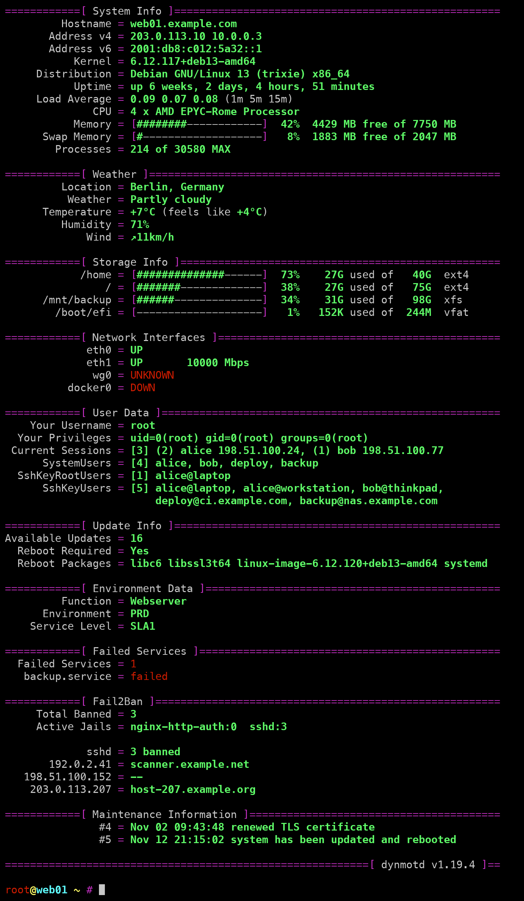

# dynmotd
Dynamic Message of the Day — a single Bash script that displays system information on login.



*Example output of v1.19 in the default color scheme. Host name, addresses, users and SSH keys in the screenshot are sample data.*

## Features

- Color schemes (switchable via config block at top of script)
- Enable/disable individual information sections
- Per-host description, environment label and SLA tag
- Maintenance log with add/delete/list support
- Automatic dependency installation on `--install`
- `--update` for non-interactive binary updates (Ansible / Puppet / cron)
- Multi-distribution support (Debian, RHEL, SUSE, Arch, Alpine families)
- All IPv4 addresses + optional IPv6 from all active interfaces
- Load average (1m / 5m / 15m) and realistic available memory (`MemAvailable`)
- Graphical utilization bars for memory, swap and disk
- Network interface state and link speed
- Optional weather section via wttr.in, cached
- Uniform `label = value` layout — the `=` sits in the same column in every section
- Optional Fail2Ban section — summary, per-jail IP list, parallel reverse DNS
- Optional Failed Systemd Services section (auto-hidden when all services are healthy)
- A switched-on section whose tool is missing says so instead of silently disappearing
- Address lookup falls back from `ip -brief` to `ip -o`, `ifconfig` and `hostname -I` for old distributions
- Parallel section rendering for fast output
- Update count cache to avoid slow package manager queries on every login
- LDAP / AD / NIS user support via `getent`
- Single self-contained shell script, no external dependencies beyond coreutils

## Supported Linux Distributions

Distributions actively supported (last ~10 years, 2015 – 2026):

### Debian family
| Distribution            | Versions / Releases          | Status              |
|-------------------------|------------------------------|---------------------|
| Debian                  | 8 (Jessie) – 13 (Trixie)     | Tested              |
| Ubuntu                  | 16.04 LTS – 24.04 LTS        | Tested              |
| Linux Mint              | 18 – 22                      | Tested              |
| Raspberry Pi OS         | Bullseye, Bookworm           | Tested              |
| Kali Linux              | Rolling (2020+)              | Tested              |
| Pop!_OS                 | 20.04 – 22.04                | Compatible          |
| Elementary OS           | 6 – 7                        | Compatible          |
| MX Linux                | 19 – 23                      | Compatible          |
| Devuan                  | 3 – 5                        | Compatible          |
| Zorin OS                | 16 – 17                      | Compatible          |

### RHEL family
| Distribution            | Versions                     | Status              |
|-------------------------|------------------------------|---------------------|
| CentOS                  | 7, 8, Stream 8/9             | Tested              |
| RHEL                    | 7, 8, 9                      | Tested              |
| Rocky Linux             | 8, 9                         | Tested              |
| AlmaLinux               | 8, 9                         | Tested              |
| Fedora                  | 35 – 41                      | Tested              |
| Oracle Linux            | 7, 8, 9                      | Compatible          |
| CloudLinux              | 7, 8                         | Compatible          |

### SUSE family
| Distribution            | Versions                     | Status              |
|-------------------------|------------------------------|---------------------|
| openSUSE Leap           | 15.x                         | Tested              |
| openSUSE Tumbleweed     | Rolling                      | Tested              |
| SLES                    | 12, 15                       | Compatible          |

### Arch family
| Distribution            | Versions                     | Status              |
|-------------------------|------------------------------|---------------------|
| Arch Linux              | Rolling                      | Compatible          |
| Manjaro                 | Rolling                      | Compatible          |
| EndeavourOS             | Rolling                      | Compatible          |

### Other
| Distribution            | Versions                     | Status              |
|-------------------------|------------------------------|---------------------|
| Alpine Linux            | 3.x                          | Compatible          |

> "Tested" = verified by the author. "Compatible" = dependency auto-install supported, not explicitly tested.
> Tell me if you have verified it on a distribution not listed here.

## Requirements

- Linux, run as root (other users get the static `/etc/motd` instead)
- Bash 4 or newer — on Alpine install it first: `apk add bash`
- Network addresses are read with whatever the system offers, newest first: `ip -brief` (iproute2 4.x and newer), `ip -o addr show` (any iproute2), `ifconfig` (net-tools), `hostname -I`. This keeps the address lines working on old distributions. The Network Interfaces section reads `/sys/class/net` directly and needs no tool.

Optional tools:

| Tool | Used for | If missing |
|---|---|---|
| `curl` | Weather section | the section shows a notice |
| `fail2ban-client` | Fail2Ban section | the section shows a notice |
| `systemctl` | Failed Services section | the section shows a notice |
| `timeout` (coreutils / busybox) | time limits for slow commands (`df` on network mounts, DNS lookups, package manager queries) | commands run without a time limit |
| `lscpu` | CPU model on ARM and other non-x86 systems | the machine architecture is shown instead |

A section that is switched on but whose tool is not installed is never dropped silently. It prints a one-line notice that names the missing tool and the switch that hides the section, for example:

```
============[ Fail2Ban ]=======================================================
         Fail2Ban = fail2ban-client not installed (hide: FAIL2BAN_INFO="0")
```

Either install the tool or set the named switch to `"0"` in the config block.

## Installation

The script must run as root.

```bash
sudo -i
git clone https://github.com/rtulke/dynmotd.git
cd dynmotd
./dynmotd.sh --install
```

`--install` automatically:
1. Detects your Linux distribution
2. Installs any missing dependencies via your native package manager
3. Copies the script to `/usr/local/bin/dynmotd`
4. Creates `/etc/profile.d/motd.sh` so dynmotd runs on every interactive login
5. Runs first-time environment setup (function, environment label, SLA)

To verify the installation, log out and back in:

```bash
exit
sudo -i
```

## Manual dependency installation

If you prefer to install packages yourself before running `--install`:

**Debian / Ubuntu / Raspberry Pi OS / Mint**
```bash
apt update && apt install -y coreutils procps hostname sed gawk grep dnsutils lsb-release
```

**CentOS 7 / RHEL 7**
```bash
yum install -y hostname procps-ng gawk bind-utils
```

**CentOS Stream 8-9 / Rocky / AlmaLinux / RHEL 8-9**
```bash
dnf install -y hostname procps-ng gawk bind-utils
```

**Fedora**
```bash
dnf install -y hostname procps-ng gawk bind-utils
```

**openSUSE / SLES**
```bash
zypper install -y hostname procps gawk bind-utils lsb-release
```

**Arch / Manjaro**
```bash
pacman -Sy inetutils procps-ng gawk bind
```

**Alpine Linux**
```bash
apk add bind-tools busybox-extras procps gawk
```

## Usage

```
Usage: dynmotd [OPTION] [value]

  e.g.  dynmotd -a "deployed new SSL certificate"

Options:

  -a | --addlog "..."           Add a maintenance log entry
  -d | --rmlog  [line-number]   Delete a log entry by line number
  -l | --log                    List all log entries
  -c | --config                 Reconfigure environment settings
  -i | --install                Install dynmotd and its dependencies
  -U | --update                 Update binary only (no setup, safe for Ansible/cron)
  -u | --uninstall              Uninstall dynmotd (log deletion is optional)
  -v | --version                Show version and exit
  -h | --help                   Show this help
```

## Uninstall

```bash
dynmotd --uninstall
```

The uninstaller asks two separate questions:
1. Whether to delete the log and configuration data in `/root/.dynmotd/`
2. Final confirmation before removing the binary and profile hook

System packages that were installed as dependencies are **never** removed automatically. Remove them with your package manager if desired.

## Update

To update an already-installed dynmotd to a newer version without running the full setup again:

```bash
cd dynmotd
git pull
sudo bash dynmotd.sh --update
```

`--update` only replaces the binary at `/usr/local/bin/dynmotd`. It does not ask setup questions, does not touch logs or configuration, and does not reinstall packages — safe to run from Ansible, Puppet, or a cron job.

Run `--install` and `--update` from the downloaded script, not from the installed binary: the installed copy cannot overwrite itself and refuses to try.

> **Note:** `--install` and `--update` replace the whole script, including the config block at its top. Re-apply local changes to the config block afterwards.

## Configuration

Edit the config block at the top of the installed script:

```bash
vim /usr/local/bin/dynmotd
```

### Enable / disable sections

Each section has an `_INFO` toggle and an optional `_ALWAYS` override:

| Variable | Default | Description |
|---|---|---|
| `SYSTEM_INFO` | `1` | System info (hostname, IPs, kernel, distribution, uptime, load, CPU, memory, swap, processes) |
| `STORAGE_INFO` | `1` | Storage / disk usage with utilization bars |
| `NETWORK_INFO` | `1` | Network interfaces — state and link speed |
| `USER_INFO` | `1` | User sessions and SSH keys |
| `UPDATE_INFO` | `1` | Available package updates |
| `UPDATE_ALWAYS` | `0` | Show Update section even when `UPDATE_INFO="0"` |
| `ENVIRONMENT_INFO` | `1` | Environment label (function, env, SLA) |
| `FAILED_SERVICES_INFO` | `1` | Failed systemd services (auto-hidden when none failed; notice if `systemctl` is missing) |
| `FAILED_SERVICES_ALWAYS` | `0` | Always show Failed Services, even when all healthy (`= none`) |
| `FAIL2BAN_INFO` | `1` | Fail2Ban summary — total banned + jail overview (notice if `fail2ban-client` is missing) |
| `FAIL2BAN_ALWAYS` | `0` | Show Fail2Ban section even when `FAIL2BAN_INFO="0"` |
| `SHOWFAIL2BAN_IPS` | `1` | List banned IPs per jail (no DNS, no delay) |
| `RESOLVEFAIL2BAN_IPS` | `1` | Resolve banned IPs via reverse DNS (parallel, requires `SHOWFAIL2BAN_IPS="1"`) |
| `FAIL2BAN_MAX_IPS` | `10` | Maximum number of banned IPs listed per jail (`0` = no limit) |
| `MAINTENANCE_INFO` | `1` | Maintenance log entries |
| `MAINTENANCE_ALWAYS` | `0` | Show Maintenance section even when `MAINTENANCE_INFO="0"` |
| `WEATHER_INFO` | `1` | Weather via wttr.in (auto-hidden if the fetch fails; notice if `curl` is missing) |
| `WEATHER_ALWAYS` | `0` | Always show Weather section, even if fetch fails (`= unavailable`) |
| `WEATHER_CITY` | *(empty)* | City for weather lookup — empty = auto-detect from server IP |
| `WEATHER_CACHE_HOURS` | `1` | Hours before weather data is re-fetched (0 = always live) |
| `WEATHER_UNITS` | *(empty)* | Unit system: `m` = metric, `u` = USCS, `M` = wind in m/s (empty = wttr.in default) |
| `VERSION_INFO` | `1` | Version banner |

`1` = enabled, `0` = disabled.

### Output layout

Every line of every section has the form `label = value`. Labels are right-aligned in a 17-character column, so the `=` is in the same column across the whole MOTD; long values wrap and continue below the value column.

Where the label is data rather than a fixed text, it is used as-is:

| Section | Label | Value |
|---|---|---|
| Storage Info | mount point | utilization bar, used / total size, filesystem type |
| Network Interfaces | interface name | state and link speed |
| Failed Services | unit name | `failed` |
| Fail2Ban | jail name, then each banned IP | number of banned IPs, then the reverse DNS name (`--` if none) |
| Maintenance Information | `#n` — the line number used by `--rmlog` | timestamp and note |

If such a label is longer than the column (a long mount point or unit name, an IPv6 address), the column is widened for that section only.

### Weather and outbound requests

The Weather section is enabled by default and is the only part of dynmotd that contacts an external service: at most once per `WEATHER_CACHE_HOURS` it sends an HTTP request to `wttr.in`. With an empty `WEATHER_CITY` the service derives the location from the server's public IP address. Set `WEATHER_INFO="0"` to disable it.

If Fail2Ban reverse lookups are enabled (`RESOLVEFAIL2BAN_IPS="1"`), banned addresses are additionally resolved through the system's DNS resolver.

### Section display order

Sections are rendered in this fixed order:

1. System Info
2. Weather
3. Storage Info
4. Network Interfaces
5. User Data
6. Update Info
7. Environment Data
8. Failed Services
9. Fail2Ban
10. Maintenance Information
11. Version banner

### Maintenance log display

```bash
LIST_LOG_ENTRY="2"      # number of log lines shown in the MOTD
```

The MOTD shows the most recent entries. The number in front of each entry is its line number in the log, as used by `--rmlog`.

### Update cache

```bash
UPDATE_CACHE_HOURS="6"  # hours before the update count is refreshed (0 = always live)
```

The update cache avoids running a full package manager check on every login. It applies to all supported package managers. The cached count is stored in `/root/.dynmotd/update_cache` and refreshed automatically when it expires; on Debian-based systems it is also refreshed as soon as packages have been installed or removed. A failed query (package manager locked, repository unreachable) is shown as `Unknown` and never cached.

### Color schemes

Seven schemes are pre-defined. Uncomment exactly one block to activate it (`F1` = labels, `F2` = borders, `F3` = values, `F4` = warnings):

| # | Name | Character |
|---|------|-----------|
| 1 | **DOT** *(default)* | grey labels · pink borders · green values |
| 2 | **Retro Hacker** | all green, Matrix style |
| 3 | **Retro Alert** | all red, maximum urgency |
| 4 | **Ocean** | cyan/blue, cool and professional |
| 5 | **Solarized Dark** | grey with warm yellow accent |
| 6 | **Nord** | ice blue, clean and modern |
| 7 | **Amber** | brown/yellow, classic CRT terminal |

Example — switching to Nord:

```bash
vim /usr/local/bin/dynmotd
```

Comment out the active scheme and uncomment Nord:

```bash
## 1. DOT - day of the tentacle (default)
#F1=${C_GREY}
#F2=${C_PINK}
#F3=${C_LGREEN}
#F4=${C_RED}

## 6. nord — ice blue, clean and modern
F1=${C_LBLUE}
F2=${C_LCYAN}
F3=${C_WHITE}
F4=${C_YELLOW}
```

## Known Issues

### Hostname not displayed correctly

The `Hostname` field uses `hostname --fqdn`. If `/etc/hostname` contains only the short name, only the short name is shown. Fix:

```bash
hostname mail.example.com
hostname > /etc/hostname
```

Also check `/etc/hosts`:
```
127.0.1.1  mail.example.com
```

> **Note:** The `Address v4` / `Address v6` fields are read directly from network interfaces via `ip -brief addr show` and are not affected by hostname resolution.

### SSH key shows "- Unknown -"

This happens when the key has no comment field. Either add a comment to the end of the key line in `~/.ssh/authorized_keys`, or generate keys with:

```bash
ssh-keygen -C "your.name@example.com"
```
