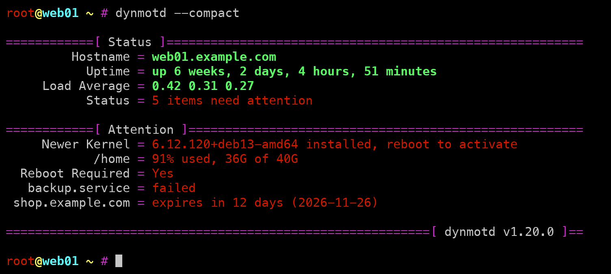

# dynmotd
Dynamic Message of the Day — a single Bash script that displays system information on login.


*Example output of v1.20 in the default color scheme. Host name, addresses, users and SSH keys in the screenshots are sample data.*

## Features

- One self-contained Bash script — nothing else to deploy, no dependencies beyond coreutils
- Uniform `label = value` layout — the `=` sits in the same column in every section
- Documented configuration file that is generated by the script and survives updates
- Warnings in a separate color: full disks, high load, pending reboot, expiring certificates, failed services, unhealthy containers, outdated backups
- Compact mode that shows a three-line summary plus only what needs attention
- System info: all IPv4/IPv6 addresses, kernel (with a hint when a newer one is installed), load, CPU, memory, swap, time synchronization
- Storage: utilization bars per filesystem, inode usage when it gets tight, software RAID, ZFS pools, LVM volume groups
- Network interface state and link speed
- Users, sessions and the SSH keys that grant access; LDAP / AD / NIS users via `getent`
- Login security: effective sshd settings, failed login attempts, most recent logins
- Pending package updates with a cache, reboot-required detection
- Failed systemd services, Docker container health
- TLS certificate expiry (certbot lineages are found automatically)
- Backup age check for directories of your choice
- Fail2Ban summary with per-jail IP list and parallel reverse DNS
- Optional weather via wttr.in, cached
- Maintenance log with add/delete/list
- Per-host description, environment label and SLA tag
- A switched-on section whose tool is missing says so instead of silently disappearing
- Works on old distributions: every tool has a fallback or is optional
- Multi-distribution support (Debian, RHEL, SUSE, Arch, Alpine families) with automatic dependency installation
- `--update` for non-interactive binary updates (Ansible / Puppet / cron), `--json` for monitoring

## Supported Linux Distributions

Distributions actively supported (last ~10 years, 2015 – 2026):

### Debian family
| Distribution            | Versions / Releases          | Status              |
|-------------------------|------------------------------|---------------------|
| Debian                  | 8 (Jessie) – 13 (Trixie)     | Tested              |
| Ubuntu                  | 16.04 LTS – 24.04 LTS        | Tested              |
| Linux Mint              | 18 – 22                      | Tested              |
| Raspberry Pi OS         | Bullseye, Bookworm           | Tested              |
| Kali Linux              | Rolling (2020+)              | Tested              |
| Pop!_OS                 | 20.04 – 22.04                | Compatible          |
| Elementary OS           | 6 – 7                        | Compatible          |
| MX Linux                | 19 – 23                      | Compatible          |
| Devuan                  | 3 – 5                        | Compatible          |
| Zorin OS                | 16 – 17                      | Compatible          |

### RHEL family
| Distribution            | Versions                     | Status              |
|-------------------------|------------------------------|---------------------|
| CentOS                  | 7, 8, Stream 8/9             | Tested              |
| RHEL                    | 7, 8, 9                      | Tested              |
| Rocky Linux             | 8, 9                         | Tested              |
| AlmaLinux               | 8, 9                         | Tested              |
| Fedora                  | 35 – 41                      | Tested              |
| Oracle Linux            | 7, 8, 9                      | Compatible          |
| CloudLinux              | 7, 8                         | Compatible          |

### SUSE family
| Distribution            | Versions                     | Status              |
|-------------------------|------------------------------|---------------------|
| openSUSE Leap           | 15.x                         | Tested              |
| openSUSE Tumbleweed     | Rolling                      | Tested              |
| SLES                    | 12, 15                       | Compatible          |

### Arch family
| Distribution            | Versions                     | Status              |
|-------------------------|------------------------------|---------------------|
| Arch Linux              | Rolling                      | Compatible          |
| Manjaro                 | Rolling                      | Compatible          |
| EndeavourOS             | Rolling                      | Compatible          |

### Other
| Distribution            | Versions                     | Status              |
|-------------------------|------------------------------|---------------------|
| Alpine Linux            | 3.x                          | Compatible          |

> "Tested" = verified by the author. "Compatible" = dependency auto-install supported, not explicitly tested.
> Tell me if you have verified it on a distribution not listed here.

## Requirements

- Linux, run as root (other users get the static `/etc/motd` instead)
- Bash 4 or newer — on Alpine install it first: `apk add bash`

Everything else is optional or has a fallback:

- Network addresses are read with whatever the system offers, newest first: `ip -brief` (iproute2 4.x and newer), `ip -o addr show` (any iproute2), `ifconfig` (net-tools), `hostname -I`. The Network Interfaces section reads `/sys/class/net` directly and needs no tool.
- Sections that depend on a tool:

| Section | Tool | Default |
|---|---|---|
| Weather | `curl` | on |
| Failed Services | `systemctl` | on |
| Fail2Ban | `fail2ban-client` | on |
| Docker | `docker` | auto |
| TLS Certificates | `openssl` | auto |
| ZFS Pools | `zpool` | auto |
| LVM Volume Groups | `vgs` | auto |

- Helpers that improve the output when present: `timeout` (time limits for slow commands such as `df` on network mounts, DNS lookups, package manager queries), `lscpu` (CPU model on ARM and other non-x86 systems), `sshd` and `last` (Login Security), `timedatectl` / `chronyc` / `ntpstat` (Time Sync), `getent`.

A section switch has three states:

| Value | Meaning |
|---|---|
| `"1"` | On. If the tool the section needs is not installed, the section prints a one-line notice instead of silently disappearing. |
| `"auto"` | On if the tool is installed, otherwise hidden without a notice. |
| `"0"` | Off. |

The notice names the missing tool and the switch that hides the section:

```
============[ Fail2Ban ]=======================================================
         Fail2Ban = fail2ban-client not installed (hide: FAIL2BAN_INFO="0")
```

`dynmotd --check` lists every section, its switch, the tool it needs and whether the tool is there.

## Installation

The script must run as root.

```bash
sudo -i
git clone https://github.com/rtulke/dynmotd.git
cd dynmotd
./dynmotd.sh --install
```

`--install` automatically:
1. Detects your Linux distribution
2. Installs any missing dependencies via your native package manager
3. Copies the script to `/usr/local/bin/dynmotd`
4. Creates `/etc/profile.d/motd.sh` so dynmotd runs on every interactive login
5. Creates the configuration file `/root/.dynmotd/dynmotd.conf` (or refreshes an existing one, keeping your values)
6. Asks for function, environment label and SLA on the first installation

To verify the installation, log out and back in:

```bash
exit
sudo -i
```

Everything dynmotd puts on a system:

| Path | Content |
|---|---|
| `/usr/local/bin/dynmotd` | the script |
| `/etc/profile.d/motd.sh` | login hook |
| `/root/.dynmotd/dynmotd.conf` | configuration |
| `/root/.dynmotd/maintenance.log` | maintenance log |
| `/root/.dynmotd/update_cache`, `weather_cache_*` | caches |

## Manual dependency installation

If you prefer to install packages yourself before running `--install`:

**Debian / Ubuntu / Raspberry Pi OS / Mint**
```bash
apt update && apt install -y coreutils procps hostname sed gawk grep dnsutils lsb-release
```

**CentOS 7 / RHEL 7**
```bash
yum install -y hostname procps-ng gawk bind-utils
```

**CentOS Stream 8-9 / Rocky / AlmaLinux / RHEL 8-9**
```bash
dnf install -y hostname procps-ng gawk bind-utils
```

**Fedora**
```bash
dnf install -y hostname procps-ng gawk bind-utils
```

**openSUSE / SLES**
```bash
zypper install -y hostname procps gawk bind-utils lsb-release
```

**Arch / Manjaro**
```bash
pacman -Sy inetutils procps-ng gawk bind
```

**Alpine Linux**
```bash
apk add bash bind-tools busybox-extras procps gawk
```

## Usage

```
Usage: dynmotd [OPTION] [value]

  e.g.  dynmotd -a "deployed new SSL certificate"

Options:

  -a | --addlog "..."           Add a maintenance log entry
  -d | --rmlog  [line-number]   Delete a log entry by line number
  -l | --log                    List all log entries
  -c | --config                 Set function, environment and service level
  -g | --genconfig              Create or refresh the configuration file
  -k | --check                  Show active sections and the tools they need
  -S | --section name [name..]  Show only the named sections
  -j | --json                   Print everything as JSON
       --compact                Show the summary and warnings only
       --full                   Show all sections
  -i | --install                Install dynmotd and its dependencies
  -U | --update                 Update binary only (no setup, safe for Ansible/cron)
  -u | --uninstall              Uninstall dynmotd, configuration and log
  -v | --version                Show version and exit
  -h | --help                   Show this help
```

Without an option dynmotd prints the MOTD.

### Single sections

```bash
dynmotd --section fail2ban
dynmotd --section storage certs backup
```

Section names: `config system weather storage raid zfs lvm network user security update environment failed_services docker certs backup fail2ban maintenance version`

### Compact mode



`dynmotd --compact` prints host name, uptime and load, followed by every line the full view would print in the warning color — or a single `OK` line if there is none. Useful on hosts you log in to often. Make it the default with `MOTD_MODE="compact"` in the configuration file; `dynmotd --full` then shows everything for one run.

### JSON

`dynmotd --json` prints the same information machine-readable, for monitoring or configuration management:

```json
{
  "version": "dynmotd v1.20.0",
  "host": "web01.example.com",
  "sections": [
    { "name": "System Info", "items": [ { "label": "Hostname", "value": "web01.example.com" } ] }
  ],
  "warnings": [
    { "label": "Reboot Required", "value": "Yes" }
  ]
}
```

`warnings` holds the same lines compact mode shows.

### Maintenance log

```bash
dynmotd -a "renewed TLS certificate"   # add an entry
dynmotd -l                             # list all entries with their numbers
dynmotd -d 3                           # delete entry 3
```

Entries are stored with an ISO timestamp and the user who made them (the invoking user when called through `sudo`). The MOTD shows the most recent `LIST_LOG_ENTRY` entries; the `#n` in front of each is the number to pass to `-d`.

## Uninstall

```bash
dynmotd --uninstall
```

The uninstaller removes the script, the login hook and — unless you answer `n` — the whole data directory `/root/.dynmotd/` with configuration, maintenance log and caches, so nothing is left behind. It asks two questions:

1. Whether to delete the data directory (default: yes)
2. Final confirmation before anything is removed (default: yes)

System packages that were installed as dependencies are **never** removed automatically. Remove them with your package manager if desired.

## Update

To update an already-installed dynmotd to a newer version without running the full setup again:

```bash
cd dynmotd
git pull
sudo bash dynmotd.sh --update
```

`--update` only replaces the binary at `/usr/local/bin/dynmotd`. It does not ask questions, does not touch the configuration or the log, and does not reinstall packages — safe to run from Ansible, Puppet, or a cron job. Your settings stay as they are, because they live in the configuration file and not in the script.

If the new version brings new settings, `--update` says so. They use their defaults until you run `dynmotd --genconfig`, which adds them to your configuration file together with their documentation.

Run `--install` and `--update` from the downloaded script, not from the installed binary: the installed copy cannot overwrite itself and refuses to try.

### Updating from a version before 1.20

Before 1.20 settings were edited in the script itself and the host description lived in `/root/.dynmotd/environment.cfg`.

- The host description (function, environment, SLA) is imported into `dynmotd.conf` automatically on the first run, and `environment.cfg` is removed.
- Changes you made to the config block of the old script (color scheme, switched-off sections, weather city) are **not** carried over. Set them once in `dynmotd.conf`.
- Color schemes are now selected by name with `COLOR_SCHEME` instead of commenting blocks in and out.

## Configuration

All settings live in one file:

```
/root/.dynmotd/dynmotd.conf
```

The file is generated by dynmotd itself and documents every setting right where you edit it. The script stays a single file: the configuration file is created from it on `--install` or on the first run.

```bash
vim /root/.dynmotd/dynmotd.conf     # edit
dynmotd --genconfig                 # create it, or refresh it after an update
dynmotd --check                     # see what is active
```

Good to know:

- **It survives updates.** `--install` and `--update` never overwrite your values.
- **It is read as plain text, never executed.** A typo cannot break your login, and the file cannot run code as root. Format: one `KEY="value"` per line, `#` starts a comment.
- **Mistakes are reported, not fatal.** A setting with an invalid value falls back to its default, an unknown or unreadable line is skipped, and the MOTD shows a `Configuration` section naming the line.
- **Missing settings use their defaults**, so a configuration file from an older version keeps working.
- **`--genconfig` is safe to run any time.** It keeps your values, adds settings that are new, and restores the comments. Comments you added yourself are not kept.
- The file must belong to root and must not be writable by anyone else (`chmod 600`), otherwise it is ignored.

### Settings

`1` = on, `0` = off, `auto` = on if the required tool is installed (see [Requirements](#requirements)).

**General**

| Setting | Default | Description |
|---|---|---|
| `MOTD_MODE` | `full` | `full` shows every active section, `compact` the summary and warnings only |
| `COLOR_SCHEME` | `dot` | `dot`, `hacker`, `alert`, `ocean`, `solarized`, `nord`, `amber`, `none` or `custom` |
| `COLOR_LABEL`, `COLOR_BORDER`, `COLOR_VALUE`, `COLOR_WARN` | `grey`, `pink`, `lgreen`, `red` | Colors for `COLOR_SCHEME="custom"` |

**Host description**

| Setting | Default | Description |
|---|---|---|
| `SYSFUNCTION`, `SYSENV`, `SYSSLA` | *(empty)* | Function, environment label and service level — set interactively with `dynmotd --config` |
| `ENVIRONMENT_INFO` | `1` | Show the Environment Data section |

**System**

| Setting | Default | Description |
|---|---|---|
| `SYSTEM_INFO` | `1` | Host name, addresses, kernel, distribution, uptime, load, CPU, memory, swap, processes |
| `TIMESYNC_INFO` | `auto` | "Time Sync" line: is the system clock synchronized |
| `MEMORY_WARN_PERCENT` | `90` | Memory in use from which the line is a warning |
| `SWAP_WARN_PERCENT` | `80` | Swap in use from which the line is a warning |
| `LOAD_WARN_PERCENT` | `100` | 1-minute load in percent of the CPU count (100 on 4 CPUs = load 4.0) |

**Weather**

| Setting | Default | Description |
|---|---|---|
| `WEATHER_INFO` | `1` | Weather via wttr.in (hidden if the request fails) |
| `WEATHER_ALWAYS` | `0` | Show the section as `unavailable` when the request fails |
| `WEATHER_CITY` | *(empty)* | City to look up — empty lets wttr.in guess from the server's public IP |
| `WEATHER_UNITS` | *(empty)* | `m` metric, `u` US customary, `M` metric with wind in m/s |
| `WEATHER_CACHE_HOURS` | `1` | Hours before the weather is fetched again (0 = every login) |

**Storage**

| Setting | Default | Description |
|---|---|---|
| `STORAGE_INFO` | `1` | One line per filesystem with a utilization bar |
| `DISK_WARN_PERCENT` | `85` | Disk usage from which a filesystem is a warning |
| `INODE_WARN_PERCENT` | `85` | Inode usage from which an extra warning line is printed |
| `RAID_INFO` | `auto` | Software RAID arrays from `/proc/mdstat`; degraded arrays are warnings |
| `ZFS_INFO` | `auto` | ZFS pools with usage and health |
| `LVM_INFO` | `auto` | LVM volume groups with size and free space |

**Network, users and logins**

| Setting | Default | Description |
|---|---|---|
| `NETWORK_INFO` | `1` | Interface state and link speed |
| `USER_INFO` | `1` | Sessions, local users and authorized SSH keys |
| `SECURITY_INFO` | `1` | Login Security: sshd settings, failed logins, recent logins |
| `SSH_PASSWORD_WARN` | `1` | Print `SSH Passwords = yes` as a warning (`0` if password logins are intended) |
| `LAST_LOGINS` | `3` | Number of recent logins listed (0 hides the list) |

**Updates**

| Setting | Default | Description |
|---|---|---|
| `UPDATE_INFO` | `1` | Pending package updates and reboot status |
| `UPDATE_ALWAYS` | `0` | Show the section even when `UPDATE_INFO="0"` |
| `UPDATE_CACHE_HOURS` | `6` | Hours before the package manager is asked again (0 = every login) |
| `UPDATE_WARN_COUNT` | `25` | Number of pending updates from which the count is a warning (0 = never) |

**Services, certificates, backups**

| Setting | Default | Description |
|---|---|---|
| `FAILED_SERVICES_INFO` | `1` | Failed systemd units (hidden while nothing has failed) |
| `FAILED_SERVICES_ALWAYS` | `0` | Show the section as `none` when nothing has failed |
| `DOCKER_INFO` | `auto` | Container counts; unhealthy, restarting and crashed containers by name |
| `DOCKER_MAX_LIST` | `10` | Maximum number of problem containers listed (0 = no limit) |
| `CERT_INFO` | `auto` | Days until TLS certificates expire |
| `CERT_FILES` | *(empty)* | Additional certificate files, space-separated, wildcards allowed |
| `CERT_WARN_DAYS` | `20` | Remaining days from which a certificate is a warning (certbot renews at 30, so less than 30 only warns when a renewal failed) |
| `CERT_MAX_LIST` | `10` | Maximum number of certificates listed, earliest expiry first (0 = no limit) |
| `BACKUP_INFO` | `auto` | Age of the newest file per backup path (shown when `BACKUP_PATHS` is set) |
| `BACKUP_PATHS` | *(empty)* | Directories or files to check, space-separated, wildcards allowed |
| `BACKUP_MAX_AGE_HOURS` | `26` | Age from which a backup is a warning (0 = never) |

**Fail2Ban**

| Setting | Default | Description |
|---|---|---|
| `FAIL2BAN_INFO` | `1` | Total banned addresses and jail overview |
| `FAIL2BAN_ALWAYS` | `0` | Show the section even when `FAIL2BAN_INFO="0"` |
| `SHOWFAIL2BAN_IPS` | `1` | List the banned addresses of each jail |
| `RESOLVEFAIL2BAN_IPS` | `1` | Resolve listed addresses via reverse DNS (parallel, needs `SHOWFAIL2BAN_IPS="1"`) |
| `FAIL2BAN_MAX_IPS` | `10` | Maximum number of addresses listed per jail (0 = no limit) |

**Maintenance log and footer**

| Setting | Default | Description |
|---|---|---|
| `MAINTENANCE_INFO` | `1` | Most recent maintenance log entries |
| `MAINTENANCE_ALWAYS` | `0` | Show the section even when `MAINTENANCE_INFO="0"` |
| `LIST_LOG_ENTRY` | `2` | Number of entries shown |
| `VERSION_INFO` | `1` | Version banner |

### Warnings

Some lines are printed in the warning color of the scheme. These are also the lines compact mode and the `warnings` list of `--json` show:

| Section | A line is a warning when |
|---|---|
| Configuration | the configuration file has an invalid value or an unreadable line |
| System Info | a newer kernel is installed than the one running; load, memory or swap reach their thresholds; the clock is not synchronized |
| Storage Info | disk or inode usage reaches its threshold |
| Software RAID / ZFS Pools | an array is degraded or inactive; a pool is not `ONLINE` or reaches the disk threshold |
| Login Security | sshd allows root logins with a password, or password logins in general |
| Update Info | a reboot is required, or the number of updates reaches `UPDATE_WARN_COUNT` |
| Environment Data | the host description has not been set |
| Failed Services | a unit has failed |
| Docker | the daemon is not reachable; a container is unhealthy, restarting, dead or exited with an error |
| TLS Certificates | a certificate expires within `CERT_WARN_DAYS`, has expired or cannot be read |
| Backups | the newest file is older than `BACKUP_MAX_AGE_HOURS`, or a path is missing or empty |
| any | a section is switched on with `"1"` but its tool is not installed |

Set a threshold to `0` to switch that warning off.

### Output layout

Every line of every section has the form `label = value`. Labels are right-aligned in a 17-character column, so the `=` is in the same column across the whole MOTD; long values wrap and continue below the value column.

Where the label is data rather than a fixed text, it is used as-is:

| Section | Label | Value |
|---|---|---|
| Storage Info, ZFS Pools | mount point / pool | utilization bar, used / total size, filesystem type or health |
| Software RAID, LVM Volume Groups | array / volume group | level and member state / size and free space |
| Network Interfaces | interface name | state and link speed |
| Failed Services | unit name | `failed` |
| Docker | container name | what is wrong with it |
| TLS Certificates | certificate name | days left and expiry date |
| Backups | path | age of the newest file |
| Fail2Ban | jail name, then each banned IP | number of banned IPs, then the reverse DNS name (`--` if none) |
| Maintenance Information | `#n` — the number used by `--rmlog` | timestamp, user and note |

If such a label is longer than the column (a long mount point or unit name, an IPv6 address), the column is widened for that section only.

### Section display order

Sections are rendered in this fixed order; a section without content is left out:

1. Configuration (only when the configuration file has problems)
2. System Info
3. Weather
4. Storage Info
5. Software RAID
6. ZFS Pools
7. LVM Volume Groups
8. Network Interfaces
9. User Data
10. Login Security
11. Update Info
12. Environment Data
13. Failed Services
14. Docker
15. TLS Certificates
16. Backups
17. Fail2Ban
18. Maintenance Information
19. Version banner

### Weather and outbound requests

The Weather section is enabled by default and is the only part of dynmotd that contacts an external service: at most once per `WEATHER_CACHE_HOURS` it sends an HTTP request to `wttr.in`. With an empty `WEATHER_CITY` the service derives the location from the server's public IP address. Set `WEATHER_INFO="0"` to disable it.

If Fail2Ban reverse lookups are enabled (`RESOLVEFAIL2BAN_IPS="1"`), banned addresses are additionally resolved through the system's DNS resolver.

### Update cache

Asking the package manager takes one to several seconds, so the number of pending updates is cached in `/root/.dynmotd/update_cache` for `UPDATE_CACHE_HOURS`. This applies to all supported package managers. On Debian-based systems the cache is also refreshed as soon as packages have been installed or removed. A failed query (package manager locked, repository unreachable) is shown as `Unknown` and never cached.

### Certificates and backups

Certificates of certbot / Let's Encrypt under `/etc/letsencrypt/live` are found automatically. Add others with `CERT_FILES`:

```
CERT_FILES="/etc/ssl/private/mail.pem /opt/app/certs/*.crt"
CERT_WARN_DAYS="20"
```

The certificates that expire first are listed on top; with more than `CERT_MAX_LIST` certificates the rest is summarized in one line.

The backup check looks for the newest file below each path (three directory levels deep) and warns when it is too old:

```
BACKUP_PATHS="/mnt/backup/daily /var/backups/db.sql.gz"
BACKUP_MAX_AGE_HOURS="26"
```

Paths in both settings are separated by spaces and may contain wildcards, but no spaces.

### Color schemes

Select a scheme by name:

```
COLOR_SCHEME="nord"
```

| Name | Character |
|------|-----------|
| `dot` *(default)* | grey labels · pink borders · green values |
| `hacker` | all green, Matrix style |
| `alert` | all red, maximum urgency |
| `ocean` | cyan/blue, cool and professional |
| `solarized` | grey with warm yellow accent |
| `nord` | ice blue, clean and modern |
| `amber` | brown/yellow, classic CRT terminal |
| `none` | no colors |
| `custom` | your own combination, see below |

For your own combination set `COLOR_SCHEME="custom"` and the four colors (labels, borders, values, warnings):

```
COLOR_SCHEME="custom"
COLOR_LABEL="grey"
COLOR_BORDER="lblue"
COLOR_VALUE="white"
COLOR_WARN="yellow"
```

Available color names: `black dgray grey white red lred blue lblue cyan lcyan pink lpink green lgreen brown yellow`

## Known Issues

### Hostname not displayed correctly

The `Hostname` field uses `hostname --fqdn`. If `/etc/hostname` contains only the short name, only the short name is shown. Fix:

```bash
hostname mail.example.com
hostname > /etc/hostname
```

Also check `/etc/hosts`:
```
127.0.1.1  mail.example.com
```

> **Note:** The `Address v4` / `Address v6` fields are read directly from network interfaces via `ip -brief addr show` and are not affected by hostname resolution.

### SSH key shows "- Unknown -"

This happens when the key has no comment field. Either add a comment to the end of the key line in `~/.ssh/authorized_keys`, or generate keys with:

```bash
ssh-keygen -C "your.name@example.com"
```
